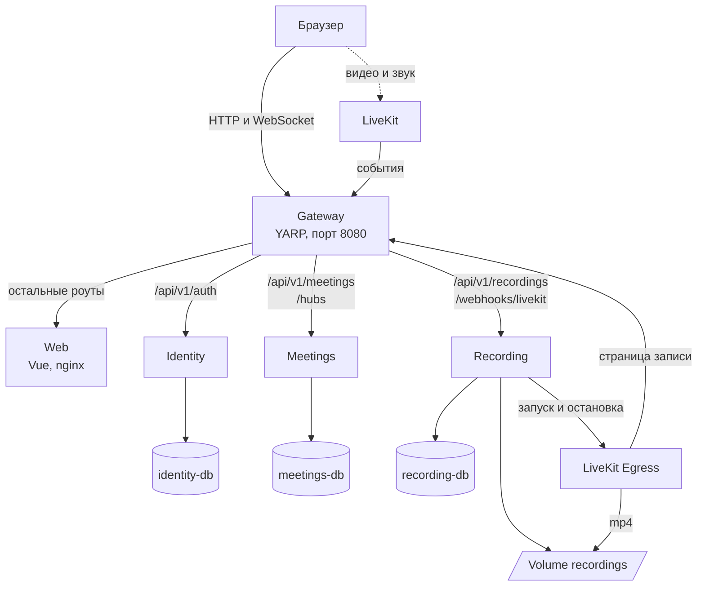
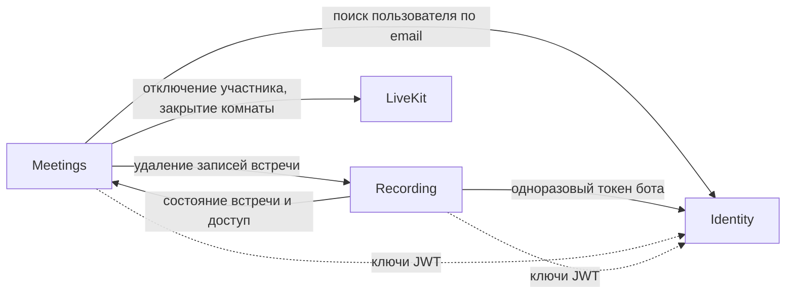
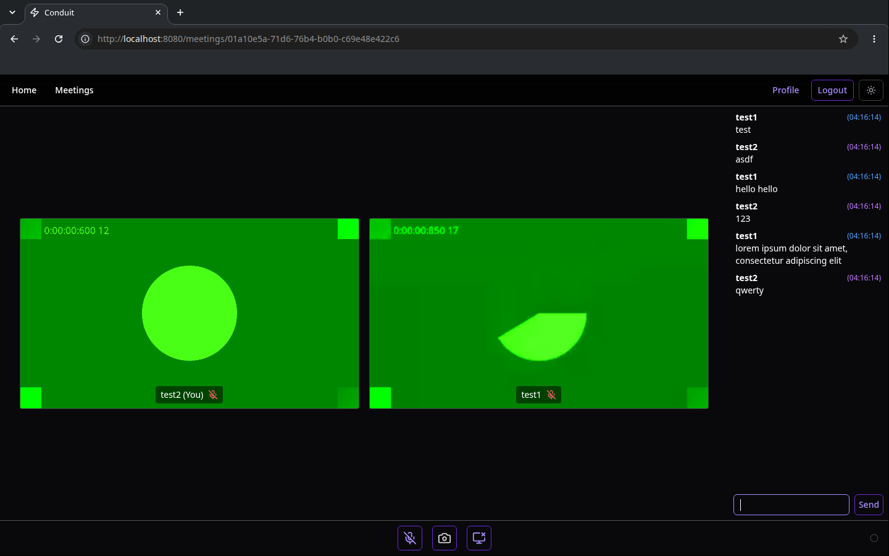
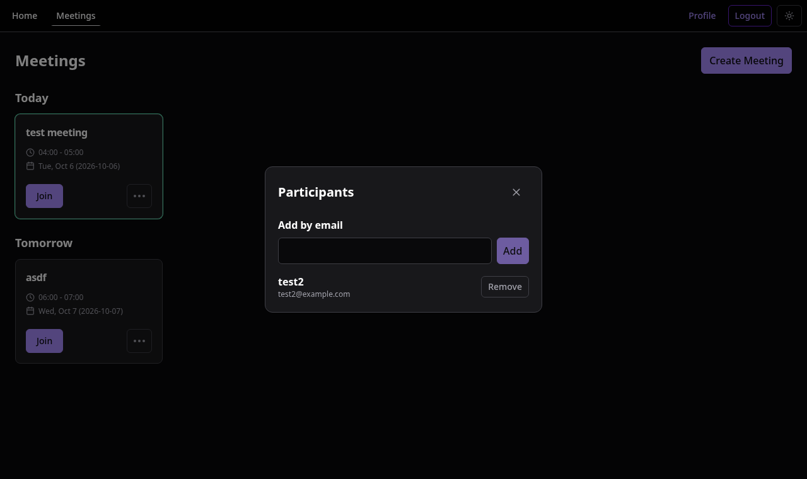
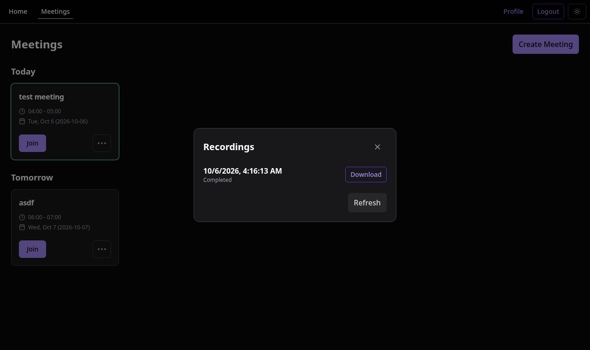
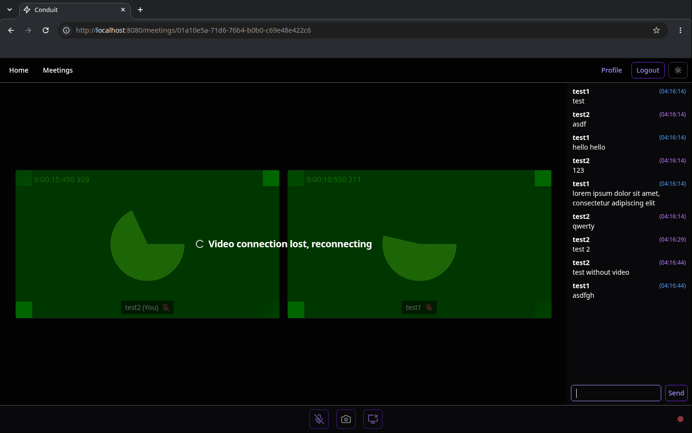
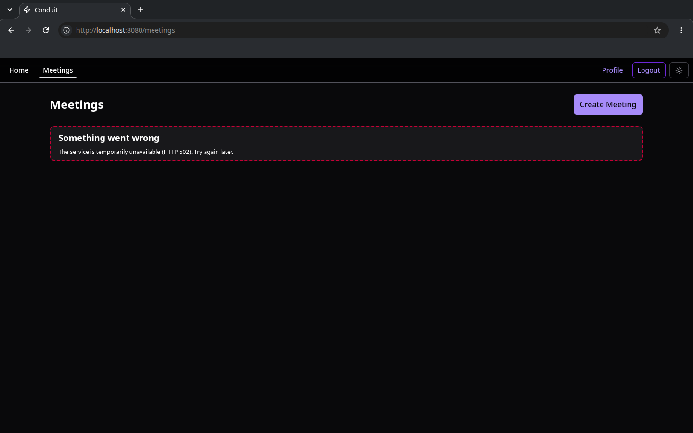
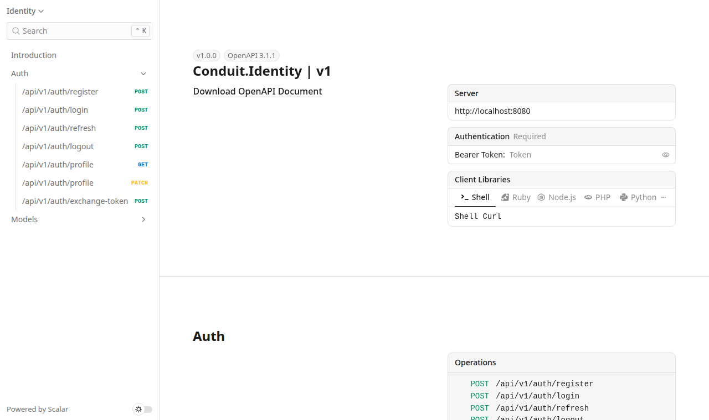

# Conduit

Conduit онлайн конференции с видеосвязью, чатом и записью. Приложение разделено на три сервиса. Браузер обращается к ним через один gateway.

## Архитектура



| Сервис | Отвечает за | Данные |
|---|---|---|
| Gateway | Принимает все запросы браузера и направляет их в нужный сервис | Нет |
| Identity | Регистрация, вход, профиль, выдача токенов | identity-db: пользователи, роли, refresh tokens |
| Meetings | Встречи, участники, чат, токены для комнаты LiveKit | meetings-db: встречи, участники, сообщения |
| Recording | Запись встреч через LiveKit Egress, список и скачивание записей | recording-db: сессии записи, volume recordings: файлы mp4 |
| Web | Отдаёт собранный клиент на Vue | Нет |

Каждый сервис является отдельным приложением ASP.NET Core на .NET 10 со своей базой PostgreSQL. Сервис читает и изменяет только свою базу. Идентификаторы из чужих баз хранятся без внешних ключей. Видео и звук идут напрямую между браузером и LiveKit.

### Gateway

Gateway построен на YARP. Браузер знает только адрес gateway `http://localhost:8080`.

| Роут | Сервис |
|---|---|
| `/api/v1/auth/*` | Identity |
| `/api/v1/meetings/*`, `/hubs/*` | Meetings |
| `/api/v1/recordings/*`, `/webhooks/livekit` | Recording |
| `/openapi/*.json`, `/docs` | Документация API всех сервисов |
| остальные роуты | Web |

Права проверяют сервисы. На роуты `/internal/*` gateway отвечает 404. Каждый запрос попадает в логи gateway с сервисом, кодом ответа и временем:

```
POST /api/v1/auth/login -> identity 200 in 60 ms
GET /api/v1/meetings -> meetings 200 in 2 ms
POST /hubs/Meeting/negotiate -> meetings 200 in 44 ms
GET /api/v1/recordings -> recording 200 in 4 ms
```

Логи открываются командой `docker compose logs -f gateway`.

### Вызовы между сервисами



| Кто вызывает | Запрос | Зачем |
|---|---|---|
| Meetings | `GET /internal/users?email=` в Identity | Найти пользователя при добавлении участника |
| Meetings | `DELETE /internal/meetings/{id}` в Recording | Остановить и удалить записи удалённой встречи. 202: запись ещё останавливается, 204: записей не осталось |
| Recording | `GET /internal/meetings/{id}/state` в Meetings | Проверить, что встреча не удалена и пользователь имеет к ней доступ |
| Recording | `POST /internal/recording-bots` в Identity | Получить одноразовый токен для страницы записи |

Сервисы обращаются друг к другу напрямую по внутренней сети Docker. Каждый внутренний запрос несёт заголовок `X-Internal-Key`, без него сервис отвечает 401. Ответ ждётся не дольше 3 секунд. Если сервис недоступен, вызывающий сервис отвечает клиенту 503.

### Вход и токены

Identity выдаёт JWT на 10 минут и refresh token на 14 дней. JWT подписан ключом RSA. Открытый ключ Identity публикует по адресу `/.well-known/jwks.json`, остальные сервисы проверяют подпись сами. После остановки Identity вошедший пользователь работает со встречами и чатом, пока не истечёт его JWT.

В токене есть идентификатор пользователя, имя для чата, роль и permissions:

```json
{
  "iss": "conduit-identity",
  "aud": "conduit-api",
  "sub": "01a10e0d-772a-7288-bd20-1e4fe00ad654",
  "name": "Alice",
  "role": "User",
  "permissions": ["meetings:view", "meetings:manage", "meetings:join", "chat:subscribe", "chat:history", "chat:send", "recordings:view"]
}
```

Refresh token одноразовый, повтор со старым токеном получает 401.

### Встречи и чат

Владелец создаёт встречу и добавляет участников по email. Встречу видят только владелец и участники. Менять название, состав и удалять встречу может только владелец. Удалённого участника Meetings сразу отключает от комнаты LiveKit.

Meetings выдаёт владельцу и участникам токен для комнаты LiveKit на 5 минут. Подключённым LiveKit продлевает его сам.

Чат работает через хаб SignalR в Meetings. Каждое сообщение получает порядковый номер внутри встречи. История выдаётся страницами по 50 сообщений после указанного номера. После обрыва связи клиент переподключается и дочитывает пропущенные сообщения. Удалённый участник сразу перестаёт получать сообщения.

### Запись

1. Когда в комнату входит первый участник, LiveKit отправляет событие `room_started` через gateway в Recording.
2. Recording проверяет в Meetings, что встреча не удалена, создаёт сессию записи и получает в Identity одноразовый токен.
3. Recording запускает LiveKit Egress. Egress открывает страницу записи через gateway. Страница обменивает одноразовый токен на JWT бота, который может только читать чат этой встречи.
4. Egress записывает видео и чат в файл mp4 в volume recordings. События Egress обновляют статус сессии.

Записи встречи открываются в меню встречи, пункт "Recordings". Файл скачивается через `GET /api/v1/recordings/{id}/file`.

### Удаление встречи

Удаление сразу скрывает встречу. Остальное делает фоновая задача Meetings раз в 15 секунд: закрывает комнату LiveKit, просит Recording остановить и удалить записи, затем удаляет сообщения и участников. Неудавшийся шаг она повторит при следующем запуске.

## Запуск

Нужен Docker с Compose. На Windows подойдёт Docker Desktop.

```sh
docker compose up -d --build
```

Первая сборка занимает несколько минут, образ LiveKit Egress занимает около 5 ГБ. После запуска приложение открывается по адресу http://localhost:8080, документация API по адресу http://localhost:8080/docs.

Для проверки встречи откройте два окна браузера, например обычное и приватное. Зарегистрируйте в них двух пользователей. Первый создаёт встречу и добавляет второго через пункт "Participants" в меню встречи. После этого оба открывают встречу и нажимают "Join".

### Windows

Браузер подключается к LiveKit напрямую. Docker Desktop не открывает браузеру адрес контейнера, поэтому на Windows нужен адрес компьютера в локальной сети:

1. Узнайте адрес IPv4 командой `ipconfig`.
2. Скопируйте `.env.example` в `.env` и впишите адрес в `LIVEKIT_NODE_IP`, например `LIVEKIT_NODE_IP=192.168.1.20`.
3. Перезапустите приложение командой `docker compose up -d`.

### Настройки

Значения по умолчанию заданы в `compose.yaml`. Изменить их можно в `.env` по образцу `.env.example`.

| Переменная | По умолчанию | Назначение |
|---|---|---|
| `LIVEKIT_NODE_IP` | пусто | Адрес, по которому браузер подключается к LiveKit |
| `GATEWAY_PORT` | `8080` | Порт gateway на компьютере |
| `LIVEKIT_API_KEY`, `LIVEKIT_API_SECRET` | ключи для разработки | Ключи API LiveKit |
| `INTERNAL_KEY` | ключ для разработки | Ключ внутренних вызовов между сервисами |

Ключи по умолчанию годятся только для запуска на своём компьютере.

## Проверка отказов

Два пользователя во встрече, сервисы останавливаются по одному:

| Команда | Что продолжает работать | Что недоступно |
|---|---|---|
| `docker compose stop livekit` | Чат, список встреч, вход | Видео. Клиент показывает "Video connection lost, reconnecting" |
| `docker compose stop recording` | Видео, чат, создание встреч | Список записей, gateway отвечает 502 |
| `docker compose stop identity` | Видео, чат и список встреч у вошедших пользователей | Вход и регистрация, gateway отвечает 502. Добавление участника, Meetings отвечает 503 |
| `docker compose stop meetings` | Вход, профиль | Встречи и чат. Страница встреч показывает ошибку |
| `docker compose stop meetings-db` | Вход, профиль | Встречи, Meetings отвечает 503 |

Сервис возвращается командой `docker compose start <имя>`, чат переподключается сам.

## Скриншоты

Встреча двух пользователей:



Добавление участника:



Готовая запись встречи:



Видеосвязь остановлена, чат работает:



Сервис Meetings остановлен:



Документация API через gateway:



## Структура

```
backend/
  Conduit.Gateway/    gateway на YARP
  Conduit.Identity/   пользователи и токены
  Conduit.Meetings/   встречи, участники, чат
  Conduit.Recording/  запись встреч
  Conduit.Shared/     проверка JWT, внутренние вызовы, обработка ошибок
  Dockerfile          общий образ, сервис выбирается аргументом SERVICE
frontend/             клиент на Vue
compose.yaml          все контейнеры приложения
```

Внутри сервиса код разложен по папкам: `Endpoints` с эндпоинтами, `Contracts` с запросами и ответами, `Data` с базой и миграциями, `Clients` с вызовами других сервисов, `Services` с остальной логикой.

Клиент запускается отдельно командой `bun run dev` в папке `frontend` и ходит в API через gateway `http://localhost:8080`.
